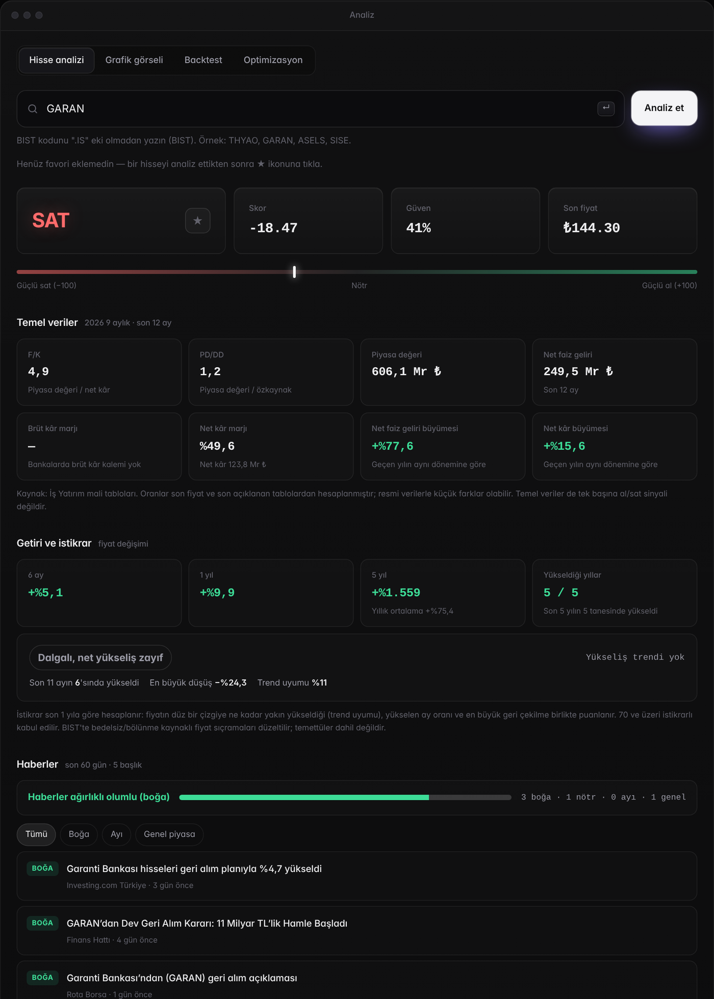
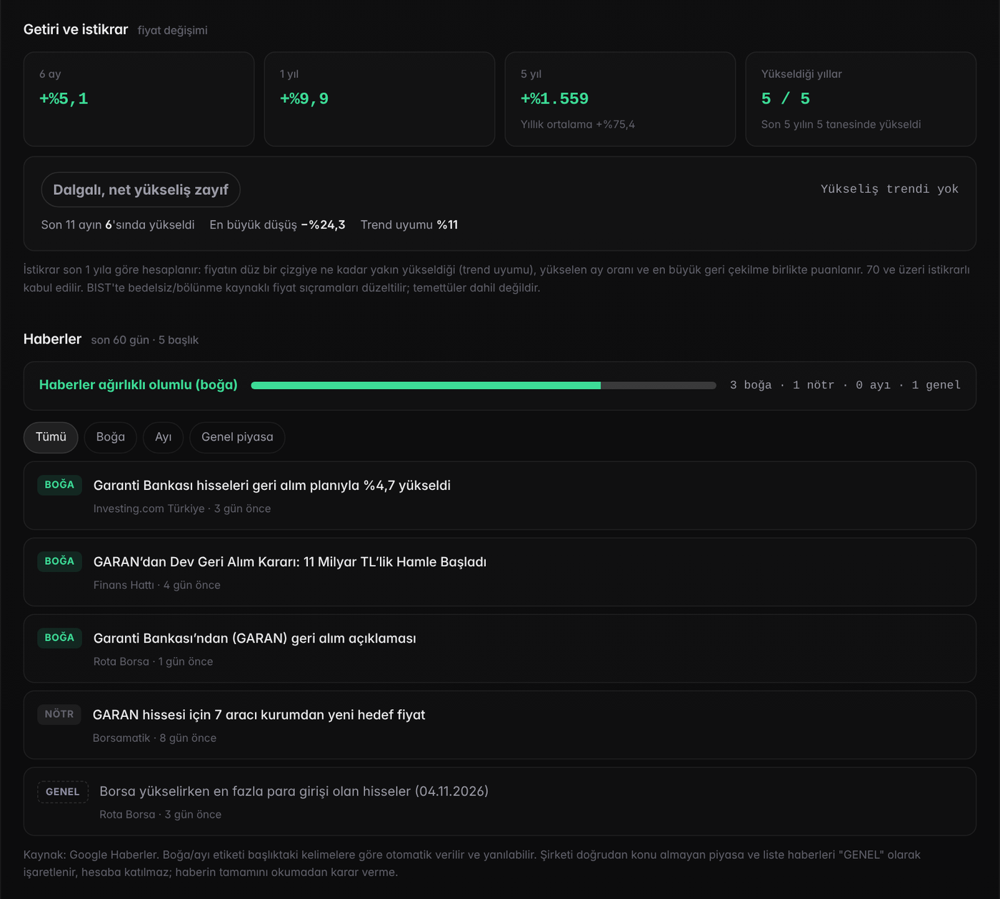

# Lidya Analiz

### 👉 Canlı site: **[lidyaanaliz.formulfit.workers.dev](https://lidyaanaliz.formulfit.workers.dev)**


BIST ve ABD (NASDAQ/NYSE) hisseleri için ücretsiz, üyeliksiz analiz aracı. Dokuz teknik göstergeyi, şirketin resmi mali tablolarından hesaplanan temel verileri, 5 yıllık getiri ve istikrar puanını ve boğa/ayı etiketli şirket haberlerini tek ekranda toplar. Karar vermez, okunur hale getirir.

Adını, tarihte ilk madeni parayı basan Anadolu uygarlığı **Lidya**'dan alır.

## Özellikler

| | |
|---|---|
| **Teknik analiz** | RSI, MACD, Bollinger, Stochastic, ADX, MA Cross, Fibonacci, OBV ve hacim sıçraması. Piyasanın trendli mi yatay mı olduğu ADX ile ölçülür, ağırlıklar buna göre değişir. |
| **Temel veriler** | F/K, PD/DD, piyasa değeri, brüt ve net kâr marjı, satış ve kâr büyümesi (son 12 ay). BIST için İş Yatırım mali tabloları, ABD için SEC EDGAR resmi bildirimleri. Bankalar, zarar eden ve gelir raporlamayan şirketler ayrıca ele alınır. |
| **Getiri ve istikrar** | 6 ay, 1 yıl ve 5 yıl getiri, yıllık ortalama getiri, son 5 yılın kaçında yükseldiği. Yükselişin istikrarlı mı dalgalı mı olduğunu 0–100 arası puanla gösterir (trend uyumu, yükselen ay oranı, en büyük düşüş). BIST'te bedelsiz/bölünme kaynaklı fiyat sıçramaları otomatik düzeltilir. |
| **Boğa / ayı haberleri** | Şirketle ilgili son haberler olumlu (boğa), olumsuz (ayı) veya nötr olarak etiketlenir. Şirketi doğrudan konu almayan piyasa ve liste haberleri "genel" olarak ayrılır. ABD haberleri kısa özetleriyle birlikte Türkçeye çevrilir. |
| **KAP açıklamaları** | BIST hisselerinde şirketin son 90 gündeki resmi KAP bildirimleri (geri alım, temettü, yeni iş ilişkisi, finansal rapor vb.) tarih sırasıyla listelenir; önemli açıklamalar işaretlenir. |
| **Backtest** | Sinyallerin geçmişte ne kadar isabetli olduğunu ölçer. |
| **Ağırlık optimizasyonu** | Göstergelerin ağırlıklarını eğitim/test ayrımıyla, seçilen hisselere göre ayarlar. |
| **Grafik görseli analizi** | Bir grafiğin ekran görüntüsünden fiyat çizgisini çıkarır ve aynı göstergelerle yorumlar. |





## Önemli bulgu

İki piyasada ve çok sayıda hissede yapılan eğitim/test ayrımlı testlerde teknik göstergelerin isabet oranı yazı-turadan (%50) anlamlı şekilde farklı çıkmadı. Bu yüzden Lidya bir "tahmin aracı" değil, göstergeleri ve verileri düzenli okunur hale getiren bir araçtır. **Yatırım tavsiyesi değildir.**

## Mimari

- **Arayüz:** Tek sayfa HTML/CSS/JavaScript, Cloudflare Workers'da barındırılır. Tüm göstergeler, backtest, optimizasyon ve görsel analizi ziyaretçinin tarayıcısında hesaplanır.
- **Veri API'si:** Cloudflare Workers (ücretsiz plan). Fiyat, mali tablo ve haber verisini toplar, Cloudflare KV ile önbelleğe alır.
- **Çeviri:** Cloudflare Workers AI.
- **Veri kaynakları:** Twelve Data ve Yahoo Finance (fiyat), İş Yatırım (BIST mali tabloları), SEC EDGAR (ABD mali tabloları), Finnhub, Google ve Bing Haberler (haberler), KAP (resmi şirket bildirimleri).
- **Güvenlik ve performans:** Kaynak sınırlaması (CORS), IP başına istek limiti, girdi doğrulama, eski veriyi gösterip arka planda yenileyen önbellek.

## Kaynak kod

Bu repo projenin **ilk sürümünün** (Python/FastAPI backend) kodunu içerir. Güncel site yeni bir altyapıyla (Cloudflare Workers) çalışmaktadır ve kodu paylaşılmamaktadır. Siteyi denemek için yukarıdaki bağlantıyı kullanın.

## Eski sürümü (Python/FastAPI) çalıştırma

Bu repodaki kod, sitenin ilk sürümünün API'sidir. İlk sürüm **Railway** üzerinde çalışıyordu; aynı şekilde kendi bilgisayarınızda ya da Railway/Render gibi bir Python barındırma servisinde çalıştırabilirsiniz. Bu sürüm artık güncellenmemektedir; temel veriler, getiri/istikrar ve haberler gibi yeni özellikler burada yoktur.

**Kendi bilgisayarında (Python 3.11+):**

```bash
git clone https://github.com/metehandghn/lidya-analiz.git
cd lidya-analiz
python -m venv .venv
# Windows: .venv\Scripts\activate   |   macOS/Linux: source .venv/bin/activate
pip install -r requirements.txt
uvicorn app.main:app --reload
```

Ardından tarayıcıda `http://127.0.0.1:8000/docs` adresini açın; tüm uç noktaları (analiz, backtest, optimizasyon, grafik görseli yükleme) buradan deneyebilirsiniz.

**Railway / Render'da:**

1. Yeni proje → bu GitHub reposunu seçin.
2. Başlatma komutu: `uvicorn app.main:app --host 0.0.0.0 --port $PORT`
3. Ortam değişkenlerini ekleyin (aşağıda).

**Ortam değişkenleri:**

| Değişken | Açıklama |
|---|---|
| `TWELVE_DATA_API_KEY` | ABD hisse fiyatları için [Twelve Data](https://twelvedata.com) ücretsiz API anahtarı. Yoksa yfinance denenir. |
| `ALLOW_SYNTHETIC_FALLBACK` | Gerçek veri alınamazsa demo veri üretilsin mi? Canlı kullanımda `false` önerilir (varsayılan `true`). |
| `DATABASE_URL` | Varsayılan: yerel SQLite (`sqlite:///./borsa_paneli.db`). İsterseniz PostgreSQL adresi verebilirsiniz. |
| `CACHE_TTL_SECONDS` | Fiyat verisinin önbellekte tutulma süresi (varsayılan 900 saniye). |

> Not: Bu repo yalnızca API'yi içerir; ilk sürümün arayüz dosyası burada yer almaz.

## Geliştirici

Metehan Dağhan · [github.com/metehandghn](https://github.com/metehandghn)

---

# Lidya Analiz (English)

**Live site:** [lidyaanaliz.formulfit.workers.dev](https://lidyaanaliz.formulfit.workers.dev)

A free stock analysis tool for Turkish (BIST) and US (NASDAQ/NYSE) stocks. It brings together nine technical indicators, fundamentals computed from official filings (P/E, P/B, margins, growth), 6-month to 5-year returns with a 0–100 trend-stability score, company news tagged as bullish, bearish or neutral (US news is translated to Turkish with short summaries) and, for BIST stocks, the company's recent official KAP (Public Disclosure Platform) filings. It also includes backtesting, train/test weight optimization and chart-screenshot analysis.

**Key finding:** in train/test validated experiments across both markets and many tickers, the hit rate of the technical signals was statistically indistinguishable from a coin flip (about 50%). Lidya is therefore presented as a reader for indicators and data, not a prediction tool. Not investment advice.

**Stack:** single-page HTML/CSS/JS on Cloudflare Workers (all analytics run in the browser), a data API on Cloudflare Workers with KV caching and Workers AI translation. Data from Twelve Data, Yahoo Finance, İş Yatırım, SEC EDGAR, Finnhub, Google/Bing News and KAP.

This repository contains the code of the **first version** (Python/FastAPI API, originally hosted on Railway). The current version runs on a new stack and its source is not published. To run the first version yourself: `pip install -r requirements.txt` then `uvicorn app.main:app --reload` and open `http://127.0.0.1:8000/docs`. On Railway/Render use the start command `uvicorn app.main:app --host 0.0.0.0 --port $PORT` and set `TWELVE_DATA_API_KEY` (optional) and `ALLOW_SYNTHETIC_FALLBACK=false`. This version is no longer maintained.

*Named after Lydia, the ancient Anatolian kingdom credited with minting the first coins.*
